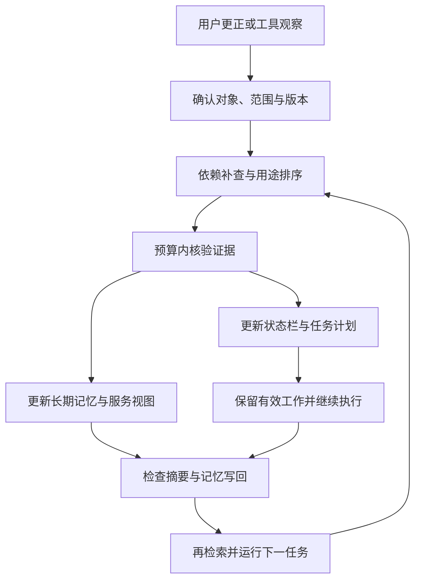

# TracePatch v0.2：记忆修复与任务接续

依据：2026-10-27 更新的《TracePatch项目思路整理_概览与技术》与原始 v0.1 规格。实施日期：2026-10-29。源码来自用户已有的 TracePatch_v0.1_demo.zip，本版是增量扩展。

## 1. 项目想解决什么

更正知识库中的一条信息，未必会改变已经生成的结论；即使结论被修好了，当前任务还可能沿旧计划继续，旧摘要也可能把错误重新写回来。

TracePatch 研究这一整条链路：**找到受到影响的内容，付出有限核验成本更新它，让任务接着做，再检查错误是否回流。**

- 长期方向：漏记的依赖如何补查，派生结论、摘要和索引如何更新。
- 短期方向：正在进行的任务如何更新状态和计划，哪些完成结果能够保留，写回时如何避免旧错误复用。
- 贯穿两方向：按当前用途安排核验，并同时衡量修复质量、可用性、工作保留与成本。

这里的工作状态是可观察的事实、结论、TODO、进度和预算；不读取或保存模型私有思维链。

图表示目标闭环。本版一次可信更正后执行三轮写回和再使用；并未实现无限多次新更正的自主循环。

## 2. 从 v0.1 到 v0.2

| 环节 | v0.1 基础 | v0.2 增量 |
|---|---|---|
| 长期存储 | 带版本、时间、范围的记忆与来源；SQLite 日志 | 保持 API，供状态与写回检查复用 |
| 找到影响 | 可见依赖 + 字符 n-gram / 实体检索 | 把当前任务用到的结论纳入候选，并优先核验 |
| 核验 | 计费读取 capsule / 原文、有限规则、UNKNOWN | 所有方法继续共享原核验器 |
| 当前状态 | 无持续任务接续 | 有效断言、TODO、完成状态、剩余核验预算 |
| 任务计划 | 修复后只读查询 | 错误的 DONE 重开；同值有效结果保留；未知等待 |
| 服务视图 | 只读当前记录 | 从已选有效声明建立可重建文本索引，按时间与范围过滤 |
| 写回 | 不执行新写入 | 检查摘要声明，写入持久化事件，再检索并继续下一任务 |
| 评价 | 长期正确率、覆盖、旧错复用、核验成本 | 任务接续、有效工作保留、再污染、首个偏离、上下文尺寸 |

## 3. 一次运行到底做什么

1. **冻结更正前的状态。** 保存已加载事实、四个已有任务、各任务绑定的依据版本和完成标记。所有方法从相同前缀开始。
2. **应用可信根更正。** 这里假设纠正本身已经诊断且可信，不研究如何判断用户和工具谁正确。
3. **安排核验。** 长期候选来自可见后继与文本/实体相似度；短期扩展再加入当前任务目标。当前任务优先，其后沿用历史使用与可观察成本排序。用途不来自未来测试问题。
4. **逐项确认。** 原证据先预留预算再读取。缺失、预算不足或规则无法判断都返回 UNKNOWN；不会把未知解释成 FALSE。
5. **更新计划。** 如果原已完成判断变错，就重开该步骤；如果仍有已核验证据支持同值结论，就保留工作。严格状态模式不会将未核验的旧 ACTIVE 内容当作当前证据。
6. **继续任务。** 确定性执行器输出 ACCEPT、DECLINE 或 WAIT_FOR_EVIDENCE。这里只模拟任务动作，不对外发送消息、下单或修改服务。
7. **摘要和写回。** 生成绑定声明的受控摘要；压力条件还会把原保留摘要作为额外写入建议提交。门禁核对主体、范围、时间、版本和值。
8. **再检索、再使用。** 写入内容进入服务索引，下一任务读取它并产生新动作，然后再摘要。默认重复三轮，记录旧错误第一次回来的位置。

## 4. 写回检查为什么有意义

只把根事实改成“8 GB”，旧的“可以运行需求 12 GB 的游戏”仍可能留在任务产物里。即使任务产物被修成“不满足”，旧摘要仍可能在之后重新进入记忆库。

写回门禁不是根据“看起来相关”来删除内容，而是检查该声明能否绑定当前核验结果：

- 当前声明值冲突：拒绝该声明，保留拒绝原因。
- 当前证据尚未核验：拒绝发布；可回答比例会下降，实验必须记录这项代价。
- 旧版本与新版本值相同，且旧版本确实存在：使用当前已核验版本重新绑定，保留有效内容。
- 时间、主体或范围不匹配：拒绝本次写回。
- 没有绑定断言的任意自由文本：拒绝进入受保护写回流程。

接受的自然语言由规范声明重建，不照搬提交文本。因此，“JSON 值正确、文字却写着旧答案”的输入不能仅凭 JSON 通过。这是受控表示上的确定性保证，不是自由文本语义核验能力。

写回保存在独立 artifact 事件中，原始证据与历史版本不被覆盖。无门禁对照允许最新摘要覆盖服务视图中的旧项，以复现回流路径；这不等于合法地修改根事实证书。

## 5. 六方法与四上下文策略

六方法使用相同任务、证据、纠正时间与预算，见 README 对照表。三个限定需要注意：

- `append_only` 与 `source_refresh` 在本确定性执行器中可能得到相同动作。这反映两个方法都未修派生状态，不能据此断言真实模型对两种提示没有差别。
- `replan` 是“同预算扫描 + 固定任务计划重建”对照，不是通用 LLM Planner 的完整实现。
- `tracepatch_state` 与 `tracepatch_guard` 使用完全相同的修复与任务状态，差异只在写回门禁，因此适合检查写回机制贡献。

上下文对照在相同已修复状态上分别产生 append、invalidate、replace、rebuild 四种消息表示，采用明确的确定性读取规则。字符数和相邻状态的共同前缀长度可以检查消息布局；没有模型调用时，不报告虚构 token、KV Cache 命中、服务费用或真实行为提升。

## 6. 实验问题与操作

| 问题 | 实际操作 | 主要结果 |
|---|---|---|
| 原长期修复是否保持可用 | 重跑原五方法 dev/test smoke | 原指标、预算、版本和冻结验证 |
| 更正后任务能否接着做 | 冻结前缀，施加同一更正，再执行剩余任务 | 初次任务正确率、完整成功率、固定序列首项动作正确率 |
| 是否保住有效工作 | 检查原 DONE 中仍正确的任务是否保留 | 有效工作保留率、重做数量 |
| 当前用途是否影响调度 | 同场景切换推荐优先与存储优先 | 不同预算下的动作与核验次序 |
| 状态表示有什么代价 | 对同一修复结果生成四种消息投影 | 字符数、共同前缀、脚本读取覆盖 |
| 错误是否真正再次写回 | 三轮摘要、旧摘要压力、门禁、写入、检索和继续任务 | 修好后再污染、旧错再检索、末轮正确率 |
| 恢复是否一致 | 在预留与提交节点注入中断，恢复后比对 | 排除墙钟时间后的事件、状态和预算一致 |

v0.2 smoke：8 个独立 test 场景 × 2 缺边条件 × 3 预算 × 2 用途 × 6 方法 = 576 个运行；dev 为独立的 2 个基础场景，共 144 个运行。固定演示为 12 个运行，额外比较无旧摘要重放和有重放。只用于机制与工程验收。

这些场景仍共享结构化任务模板，不能把 576 次条件运行写成 576 个独立真实任务，也不能把合成结果写成真实 Agent 的学术结论。

## 7. 指标口径

| 指标 | 分子 / 分母或含义 |
|---|---|
| `task_accuracy` | 初次续做正确判断数 / 前缀任务数；UNKNOWN 计未正确 |
| `task_coverage` | 有明确判断的任务数 / 前缀任务数 |
| `task_success` | 本次全部四个任务判断正确才为 1 |
| `next_action_correct` | 固定序列首项的动作判断是否正确，可为复用已有工作；不等同真实 Agent 的下一工具调用 |
| `effective_work_retention` | 被保留且仍正确的原 DONE / 原本正确的 DONE |
| `stale_action_reuse` | 续做中仍使用旧错误的目标 / 初始错误的任务目标 |
| `recontamination_rate` | 末轮写入错误的、原已修好目标 / 写回前已修好的原错误任务目标 |
| `final_stale_retrieval` | 末轮检索到旧错误的目标 / 初始错误的任务目标 |
| `final_task_accuracy` | 最后一轮再使用的正确动作数 / 前缀任务数 |
| `spent_units` | 实际原证据读取与规则核验单位；不是钱或总成本 |
| `guard_comparisons` | 所有轮门禁的内存声明检查次数，单列而非混入核验预算 |
| `elapsed_seconds` | 当前环境的实际整次运行耗时；并行执行会影响它 |

分母为零输出 NA，不用零伪装成功。`rejected_correct_claims` 记录值本身正确但因缺乏证书等原因未发布的声明，避免把过度隔离写成优势。长期 usage/uniform 查询保留在 long_term.csv 和 per_query.csv；修复器看不到 gold 和未来查询。

汇总先在每基础场景内平均条件副本，再跨场景平均；原 v0.1 报告仍保留其配对 cluster bootstrap。本版工程 smoke 不输出新的显著性结论。

## 8. 已知困难和下一阶段

1. **依赖不完整。** 文本候选只能补查一部分；真实场景须评估检索漏召回，而非假设全部找到。
2. **写回的语义。** 受控声明可以做准确版本核对，自由自然语言仍需要提取、引用与语义核验；引文存在不等于结论语义正确。
3. **真实任务接续。** 本版固定四任务执行器只能证明接口和状态机制。下一版接入模型动作适配器，先做冻结前缀的允许动作回归，再做端到端任务。
4. **缓存与上下文。** 当前只有消息层投影。真实 token 和缓存成本必须从服务返回取得，KV Cache 局部编辑另设研究，不与消息替换混淆。
5. **多次更正与外部数据。** 主实验只有一次可信纠正，后续应扩展多次到达的 UPDATE/范围变更，并用 GameReach 等项目的实际产物验证。
6. **自主多轮补查。** 当前仍是可解释的调度器，不声称 Agentic RAG。可把检索/原文读取暴露为模型工具，但需要保持相同预算、信息边界与冻结评价。

拟研究的切口是“不完整依赖下，按当前用途安排修复并控制继续执行与写回的代价”。级联修复、选择性重放和保留有效工作已有相关研究，不能直接声称本项目首次提出。
